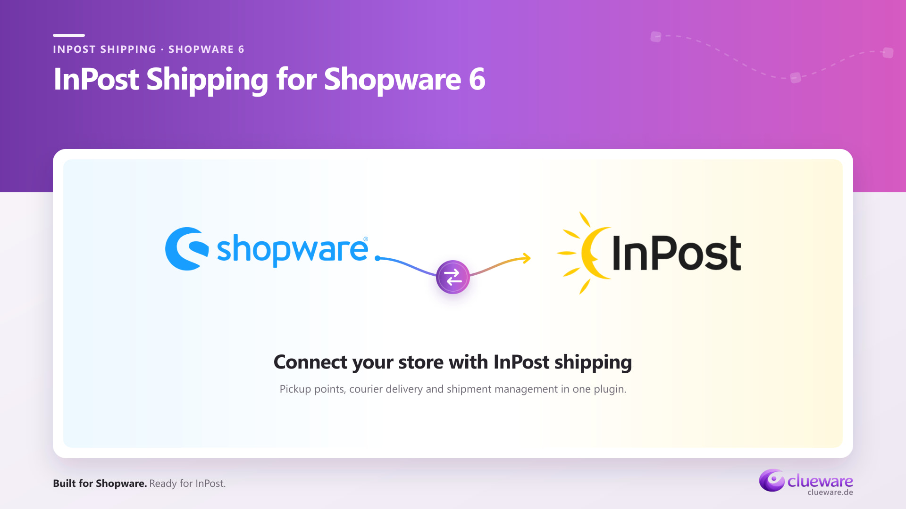

# InPost Shopware Plugin

**Free InPost shipping integration for Shopware 6.7 — parcel lockers, courier delivery, PDF labels and shipment tracking.**

[](https://www.shopware.com/)
[](LICENSE)
[](https://github.com/pgawdzik/inpost-shopware-plugin/releases/latest)

[Download ZIP](https://github.com/pgawdzik/inpost-shopware-plugin/releases/download/v2.0.15/CluewareInpostShipping-2.0.15.zip) · [Plugin website](https://clueware.de/en/inpost-shopware-plugin) · [Installation](#installation) · [Configuration](#configuration) · [Report an issue](https://github.com/pgawdzik/inpost-shopware-plugin/issues)

**Documentation:** English · [Polski](docs/README.pl.md) · [Deutsch](docs/README.de.md)

This InPost Shopware plugin connects your Shopware 6 store to the InPost ShipX API in Poland. Customers choose a parcel locker or pickup point directly at checkout. Your team creates shipments, downloads PDF shipping labels and checks tracking from the Shopware order view.

Built by [Clueware](https://clueware.de). Free to use and modify under the [MIT license](LICENSE).

## What you can do

| At checkout | In Shopware Administration |
| --- | --- |
| Select an InPost parcel locker or pickup point with Geowidget | Create an InPost shipment from an order |
| Offer parcel locker and courier delivery | Download a PDF label in A6 or A4 format |
| Keep the chosen pickup point with the order | Open tracking, refresh shipment status and cancel eligible shipments |
| Require a recipient phone number for InPost delivery | Configure each sales channel separately |

Also included:

- Cash on delivery support.
- Automatic weight calculation and parcel-size suggestions.
- Manual parcel dimensions for courier shipments.
- Sandbox and production modes with a ShipX connection test.
- Server-side pickup-point validation and a saved pickup-point snapshot.
- Dedicated Administration permissions and a shipment operation log.
- English, German and Polish interface translations.
- Bundled Storefront and Administration assets.

### Parcel locker selection in checkout


## Requirements

- A self-hosted Shopware **6.7.x** installation with Core and Storefront. Both Composer constraints are `~6.7.0`, allowing `>=6.7.0 <6.8.0`.
- The PHP version and other system requirements of your Shopware installation.
- At least one existing Shopware shipping method with an assigned delivery time, used as the initial delivery-time reference during installation.
- Your own InPost ShipX API token and organization ID for shipment management.
- A public, domain-bound InPost Geowidget token for parcel locker selection.

The plugin is free; InPost shipping services require your own InPost account. Countries available in Geowidget do not by themselves confirm that a shipment service is available through your ShipX account.

## Installation

### Upload the release ZIP

1. Download **CluewareInpostShipping-2.0.15.zip** from [Releases](https://github.com/pgawdzik/inpost-shopware-plugin/releases/latest).
2. In Shopware Administration, open **Extensions → My extensions → Upload extension**.
3. Upload the ZIP, install **InPost Shipping** and activate it.
4. Review the new shipping methods' prices, delivery times and availability rules before enabling the integration. Their initial shipping prices are **0**.
5. Open the plugin configuration and follow the steps below.

The release ZIP includes compiled assets and the correct `CluewareInpostShipping/` directory. Use this installation asset for the upload.

### Install from source

From your Shopware project root:

```bash
git clone https://github.com/pgawdzik/inpost-shopware-plugin.git custom/plugins/CluewareInpostShipping
php bin/console plugin:refresh
php bin/console plugin:install --activate CluewareInpostShipping
php bin/console assets:install
php bin/console theme:compile
php bin/console cache:clear
```

For an existing installation, deploy the new plugin files and run `php bin/console plugin:refresh` followed by `php bin/console plugin:update CluewareInpostShipping`. Then install assets, compile the theme and clear the cache as above.

## Configuration


Configure the plugin for each sales channel that should offer InPost delivery:

1. Review the shipping methods' prices, delivery times and availability rules.
2. Choose **Sandbox** or **Production** and enter the private **ShipX API token** and **organization ID** for that environment.
3. For parcel lockers, enter the public **Geowidget token** bound to your storefront domain.
4. Choose the countries shown in Geowidget, the enabled InPost services, label format and default parcel settings.
5. Decide whether to show Shopware's native address phone field automatically. InPost deliveries require a recipient phone number.
6. Enable the integration for the intended sales channel and save. The plugin synchronizes the InPost shipping-method assignments with its sales-channel configuration; check the resulting availability in your storefront.
7. Use **Test ShipX connection** after saving. It checks ShipX organization credentials across configured sales channels; it does not validate the Geowidget token.

Installation creates the InPost parcel locker and courier shipping methods. They remain unavailable until the required sales-channel configuration is present. Courier delivery requires enabled integration and ShipX credentials; parcel locker delivery also requires a Geowidget token.

## Manage shipments

Open an order using an InPost delivery method to access its **InPost shipment** card. Create the shipment, download its label, open tracking or refresh the status. Cancellation is offered for eligible InPost shipment statuses.

Recipient phone numbers stay in Shopware's standard address data. The selected pickup point is saved with the order so that historical delivery details remain available.

## Scope and common questions

**Is this an official InPost plugin?**

This is an independent integration maintained by Clueware. Shopware and InPost names and logos belong to their respective owners.

**Does it support every InPost country?**

Shipment operations use the InPost Poland ShipX API. Geowidget can display configured countries, but shipment services depend on your ShipX account and enabled services.

**Are bulk shipping and returns included?**

The plugin handles individual shipments. Bulk operations, return workflows, multiple parcels per shipment and courier pickup requests are outside the current scope.

**Which Shopware versions are supported?**

This `2.x` code line targets Shopware 6.7. The earlier `1.x` line targeted Shopware 6.5 and 6.6; those versions are outside this release's Composer constraints.

**The shipping-method icons are missing. What can I run?**

```bash
php bin/console clueware:inpost:assign-shipping-method-media
```

**Where are the API credentials stored?**

The plugin reads them from Shopware system configuration per sales channel. The private ShipX token is not sent to Storefront JavaScript. Geowidget uses its separate public token.

## Data processing

Creating a shipment sends the recipient and shipment data needed for delivery to InPost ShipX, including the recipient's name, email, phone number, address and selected pickup point where applicable. Geowidget loads when the customer opens the pickup-point selector.

When the map opens, the integration can use the delivery street and postcode to find a nearby InPost point, with postcode and city fallbacks. Keep your store's privacy information and any Shopware Store listing consistent with these integrations.

## Development and packaging

The repository includes PHP, Twig, Storefront JavaScript/SCSS, Administration source files and the compiled frontend assets used by this release. Keep `src/Resources/public/administration/.vite/` in deployments; its hidden manifests are part of the compiled Administration assets.

To create the same installable ZIP locally, run this from the repository root with Python 3:

```bash
python scripts/build-release.py
```

The builder reads the version from `composer.json` and writes `dist/CluewareInpostShipping-<version>.zip` plus a SHA-256 checksum. It includes the source, documentation, license and compiled assets, and excludes Git metadata and local dependencies.

## Support and contributions

Report reproducible problems through [GitHub Issues](https://github.com/pgawdzik/inpost-shopware-plugin/issues). Include the Shopware and plugin versions, delivery method, environment and steps to reproduce. Remove API tokens and customer data from reports and screenshots.

Pull requests are welcome. For features or larger changes, open an issue first so the implementation can be discussed.

See [CHANGELOG.md](CHANGELOG.md) for the release history and [LICENSE](LICENSE) for the MIT terms.
