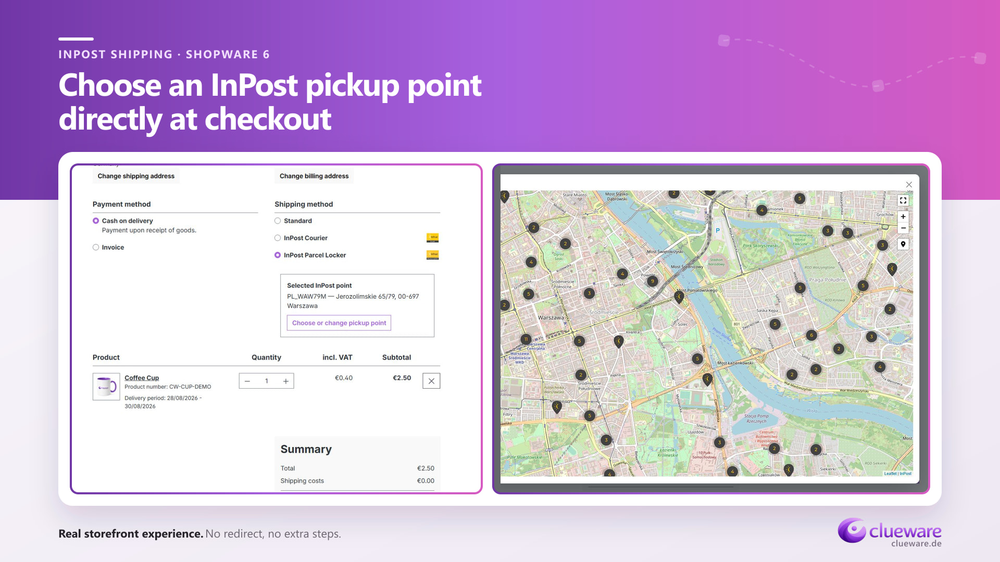
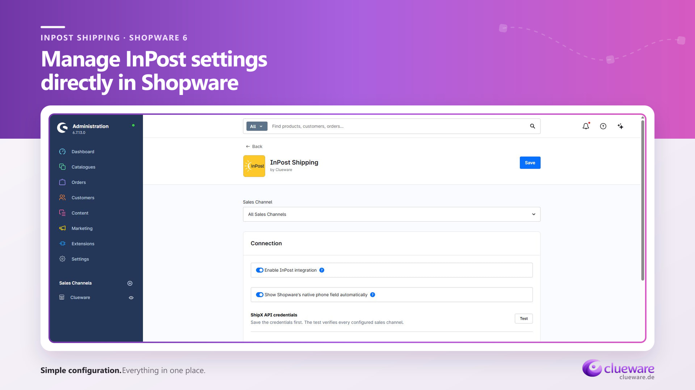

# InPost Shopware Plugin — kostenlose InPost-Integration für Shopware 6

[English](../README.md) · [Polski](README.pl.md) · **Deutsch**

Verbinden Sie Ihren Shopware 6 Shop mit InPost ShipX. Kunden wählen Paketautomaten oder Abholpunkte direkt im Checkout. Sie erstellen Sendungen, laden PDF-Etiketten herunter und prüfen den Versandstatus in der Shopware-Administration.

Das Plugin wird von [Clueware](https://clueware.de) entwickelt und unter der [MIT-Lizenz](../LICENSE) kostenlos bereitgestellt.

**[Aktuelle Version herunterladen](https://github.com/pgawdzik/inpost-shopware-plugin/releases/latest)** · [Problem melden](https://github.com/pgawdzik/inpost-shopware-plugin/issues)

## Funktionen

- Auswahl von Paketautomaten und Abholpunkten über InPost GeoWidget im Checkout.
- Versand an Abholpunkte sowie Zustellung per InPost-Kurier.
- Erstellung einzelner Sendungen direkt aus der Bestellansicht.
- PDF-Versandetiketten im Format A6 oder A4.
- Sendungsnummer, Statusaktualisierung und Stornierung von Sendungen.
- Nachnahme, automatische Gewichtsberechnung und Vorschläge für die Paketgröße.
- Manuelle Paketabmessungen für Kuriersendungen.
- Eigene Konfiguration für jeden Verkaufskanal.
- Sandbox und Produktion, ShipX-Verbindungstest und Vorgangsprotokoll.
- Separate Administrationsberechtigungen für die Versandverwaltung.
- Englische, deutsche und polnische Übersetzungen der Benutzeroberfläche.

## Abholpunkt im Checkout auswählen

Der ausgewählte Abholpunkt wird serverseitig geprüft und mit der Bestellung gespeichert. Kunden können die Karte erneut öffnen und den Abholpunkt vor Abschluss der Bestellung ändern.



## Voraussetzungen

| Komponente | Voraussetzung |
|---|---|
| Shopware | Eigene Installation von Shopware **6.7.x** mit Storefront |
| PHP | Eine mit Ihrer Shopware-Installation kompatible PHP-Version |
| Versandarten | Eine vorhandene Versandart mit zugeordneter Lieferzeit — für die Installation erforderlich |
| ShipX | Eigener API-Token und eigene Organisations-ID für InPost ShipX |
| GeoWidget | Öffentlicher, an die Shop-Domain gebundener Token für die Abholpunktauswahl |

Die Versandintegration verwendet InPost ShipX in Polen. Die Länderauswahl in GeoWidget steuert die Kartenanzeige; die verfügbaren Versanddienste richten sich nach Ihrem ShipX-Konto.

## Installation per ZIP-Datei

1. Öffnen Sie die [aktuelle Veröffentlichung](https://github.com/pgawdzik/inpost-shopware-plugin/releases/latest).
2. Laden Sie unter **Assets** das Installationspaket **`CluewareInpostShipping-2.0.15.zip`** herunter.
3. Öffnen Sie in Shopware **Erweiterungen → Meine Erweiterungen** und wählen Sie die Funktion zum Hochladen einer Erweiterung.
4. Laden Sie die ZIP-Datei hoch, installieren und aktivieren Sie **InPost Shipping**.
5. Öffnen Sie die Plugin-Konfiguration und führen Sie die folgenden Schritte aus.

Das Installationspaket enthält das Plugin mit vorbereiteten Administrations- und Storefront-Ressourcen. Verwenden Sie dieses Paket anstelle des automatisch von GitHub erstellten Archivs **Source code**.

### Installation aus dem Quellcode

Legen Sie die Dateien dieses Repositorys unter `custom/plugins/CluewareInpostShipping` Ihrer Shopware-Installation ab. Führen Sie anschließend im Hauptverzeichnis des Shops folgende Befehle aus:

```bash
bin/console plugin:refresh
bin/console plugin:install --activate CluewareInpostShipping
bin/console cache:clear
```

Berücksichtigen Sie die Kompilierung des Themes im Bereitstellungsprozess Ihres Shops, damit die Storefront-Erweiterungen geladen werden.

## Konfiguration



1. Wählen Sie den Verkaufskanal, den Sie konfigurieren möchten.
2. Wählen Sie **Sandbox** oder **Produktion** als Umgebung.
3. Tragen Sie den **privaten ShipX API-Token** und die **Organisations-ID** ein.
4. Hinterlegen Sie für Paketautomaten und Abholpunkte den **öffentlichen GeoWidget-Token**, der an Ihre Shop-Domain gebunden ist.
5. Wählen Sie die angezeigten Länder, InPost-Dienste, das Etikettenformat und die Standardwerte für Pakete.
6. Speichern Sie die Einstellungen und führen Sie den ShipX-Verbindungstest aus. Er prüft den Zugriff auf die ShipX-Organisation in allen konfigurierten Verkaufskanälen. Prüfen Sie die GeoWidget-Abholpunktauswahl separat im Checkout.
7. Prüfen Sie vor dem Aktivieren der Integration die Versandkosten, Lieferzeiten und Verfügbarkeitsbedingungen der InPost-Versandarten. Die anfänglichen Versandkosten betragen **0**; legen Sie daher die für Ihren Shop passenden Preise fest. Aktivieren Sie anschließend die Integration und speichern Sie die Konfiguration.

Bei der Installation werden die Versandarten **InPost Paczkomat** und **InPost Kurier** angelegt. Sie bleiben nicht verfügbar, bis die benötigte Konfiguration für den Verkaufskanal vorliegt. Beim Speichern der Konfiguration wird die Zuordnung dieser Versandarten zu den Verkaufskanälen automatisch synchronisiert.

InPost-Sendungen benötigen eine Telefonnummer des Empfängers. Bei aktiver Integration zeigt das Plugin standardmäßig das native Telefonfeld in den Shopware-Adressen an. Verpflichtend ist die Telefonnummer bei Bestellungen mit einer InPost-Versandart.

## Sendungen verwalten

Öffnen Sie eine Bestellung mit einer InPost-Versandart und suchen Sie die Sendungskarte. Prüfen Sie Gewicht, Paketgröße oder Abmessungen, einen optionalen Nachnahmebetrag und das Etikettenformat. Erstellen Sie anschließend die Sendung. Danach können Sie das Etikett herunterladen, die Sendungsverfolgung öffnen, den Status aktualisieren oder die Sendung stornieren, sofern ihr InPost-Status dies zulässt.

## Umfang und Daten

Das Plugin unterstützt einzelne Sendungen. Stapelverarbeitung, Retouren, mehrere Pakete innerhalb einer Sendung und die Beauftragung einer Kurierabholung sind nicht enthalten. Das Plugin ist kostenlos; Versandleistungen werden über InPost abgerechnet.

Der private ShipX-Token bleibt auf dem Server. Beim Erstellen einer Sendung werden die für die Zustellung benötigten Empfänger- und Sendungsdaten an InPost übermittelt. GeoWidget wird beim Öffnen der Abholpunktauswahl geladen und verwendet den öffentlichen Token.

## Hilfe und Lizenz

Melden Sie Fehler und Verbesserungsvorschläge über [GitHub Issues](https://github.com/pgawdzik/inpost-shopware-plugin/issues). Geben Sie die Shopware- und Plugin-Version sowie Schritte zur Reproduktion an. Lassen Sie API-Token und Kundendaten weg.

Der Quellcode steht unter der [MIT-Lizenz](../LICENSE). Das Projekt wird von [Clueware](https://clueware.de) entwickelt.
